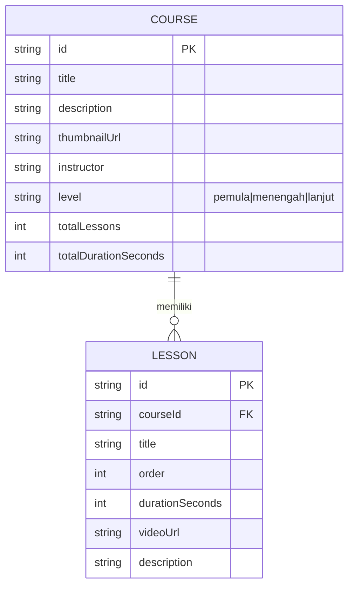

# Model data dan kontrak API

## Entitas



`CourseDetail` bukan tabel; itu hasil gabungan `Course` dan daftar `Lesson` untuk satu kelas.

Aturan parsing:

- `id`, `title`, `level` wajib. Null atau string kosong → `FormatException`.
- `description`, `thumbnailUrl`, `instructor` opsional → string kosong.
- Angka opsional → 0; tipe salah → `TypeError`, yang diterjemahkan repository menjadi `FailureType.parsing`.
- `level` hanya boleh `pemula`, `menengah`, atau `lanjut`.
- `videoUrl` wajib dan tidak boleh kosong.
- Envelope harus memiliki `"success": true`.

## Endpoint

| Metode | Path | Hasil |
|---|---|---|
| GET | `/courses` | `List<Course>` |
| GET | `/courses/{id}` | `CourseDetail` |

Base URL: `AppConfig.baseUrl`, diisi lewat `--dart-define=BASE_URL=...`.

## Bentuk envelope

Daftar kelas:

```json
{
  "success": true,
  "meta": { "total": 5 },
  "data": [
    {
      "id": "c-flutter-pemula",
      "title": "Flutter untuk Pemula",
      "description": "Belajar Flutter dari nol.",
      "thumbnailUrl": "https://...",
      "instructor": "Rani Kusuma",
      "level": "pemula",
      "totalLessons": 8,
      "totalDurationSeconds": 6660
    }
  ]
}
```

Detail kelas:

```json
{
  "success": true,
  "data": {
    "id": "c-flutter-pemula",
    "title": "Flutter untuk Pemula",
    "description": "Belajar Flutter dari nol.",
    "thumbnailUrl": "https://...",
    "instructor": "Rani Kusuma",
    "level": "pemula",
    "totalLessons": 8,
    "totalDurationSeconds": 6660,
    "lessons": [
      {
        "id": "l-fp-01",
        "courseId": "c-flutter-pemula",
        "title": "Memasang Flutter dan VS Code",
        "order": 1,
        "durationSeconds": 575,
        "videoUrl": "https://www.youtube.com/watch?v=3IzMppLBPGo",
        "description": "Instalasi SDK dan VS Code."
      }
    ]
  }
}
```

Mock memakai satu berkas `assets/mock/api/courses.json` untuk kedua endpoint. Karena bentuknya sama, perpindahan ke API nyata tidak mengubah parser, repository, atau UI.

## Video

Ada dua bentuk `videoUrl` yang dikenali:

| Bentuk | Player | Kontrol |
|---|---|---|
| `https://...mp4` | `video_player` | Kontrol khusus aplikasi |
| `https://www.youtube.com/watch?v=...` | `youtube_player_iframe` | Kontrol YouTube resmi |

YouTube dipilih karena stream tidak boleh diekstrak dan diputar di luar kebijakan pembuat. String `v` harus 11 karakter `[A-Za-z0-9_-]`; jika tidak, dianggap URL tidak valid dan ditampilkan pesan galat.

`durationSeconds` pada data kurasi diambil dari durasi video sumber, bukan estimasi. Detail tiap sumber ada di `docs/video-sources.md`.

## Failure

| Tipe | Sumber | Contoh pesan |
|---|---|---|
| `offline` | `SocketException`, `connectionError` | "Tidak ada internet..." |
| `timeout` | Timeout Dio | "Koneksi terlalu lambat..." |
| `server` | HTTP 5xx | "Server sedang bermasalah..." |
| `notFound` | HTTP 404 / id tidak ada di mock | "Kelas tidak ditemukan." |
| `parsing` | JSON rusak atau field salah tipe | "Data tidak bisa dimuat..." |
| `unknown` | Lainnya | "Terjadi kesalahan..." |

`notFound` tidak mendapat tombol retry karena mengulang permintaan yang sama tidak akan membantu.
