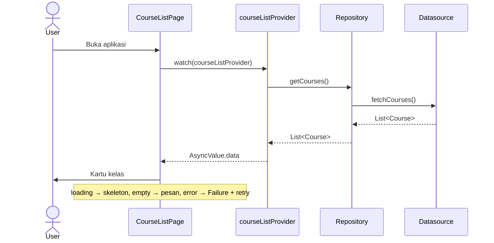
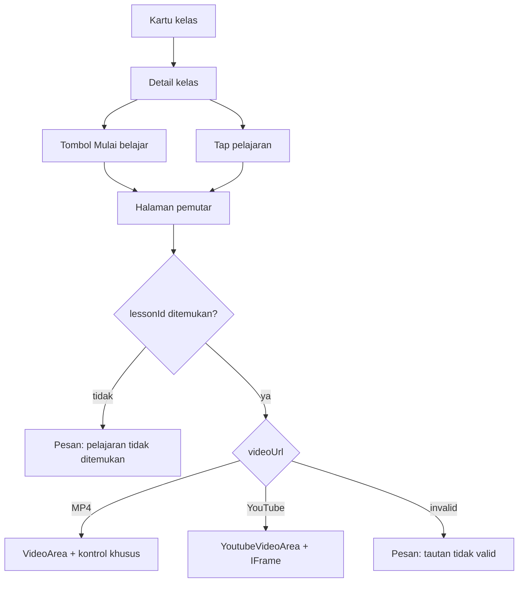
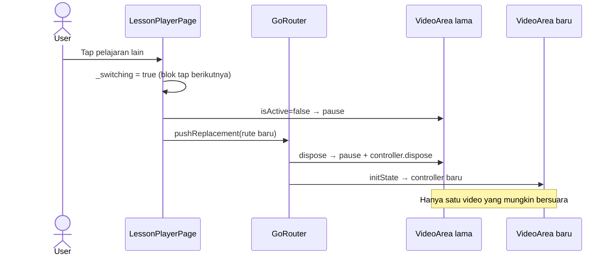
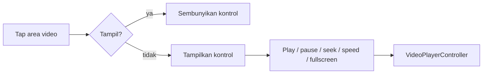
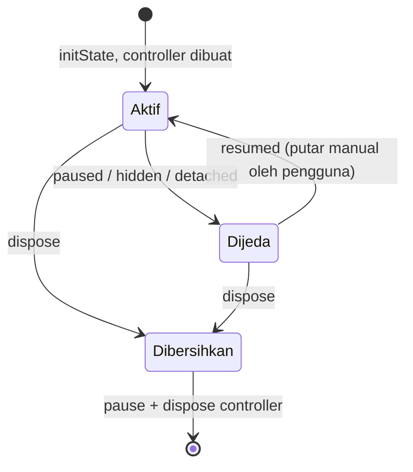

# Alur utama

## 1. Membuka daftar kelas

## 2. Membuka pelajaran

## 3. Pergantian pelajaran

Router dapat memperbarui State yang sama untuk pola rute identik. `didUpdateWidget` mengganti `_videoKey` dan mereset `_switching` agar controller lama tidak dipakai ulang.

## 4. Putaran kontrol MP4

Kontrol tidak punya timer auto-hide. Player yang dijeda tetap menunjukkan kontrolnya.

## 5. Daur hidup saat aplikasi ke latar belakang

Tidak ada autoplay setelah `resumed`: pengguna memutuskan kapan melanjutkan.

## 6. Layar penuh

`_setFullscreen(true)` mengunci orientasi landscape, menyembunyikan AppBar, dan memindahkan `VideoArea` ke body `Scaffold`. GlobalKey memindahkan elemen yang sama. Saat keluar atau halaman dibuang, orientasi dikembalikan ke portrait.

## 7. Retry

| Layar | Pemicu | Aksi |
|---|---|---|
| Daftar kelas | Tombol "Coba lagi" | `ref.invalidate(courseListProvider)` |
| Detail kelas | Tombol "Coba lagi" | `ref.invalidate(courseDetailProvider(id))` |
| MP4 gagal | Tombol "Coba lagi" | Controller lama dibuang, controller baru dibuat |
| YouTube gagal | "Buka di YouTube" | Membuka sumber di aplikasi/browser eksternal |

Auto-retry Riverpod sengaja dimatikan agar pengguna melihat pesan galat dan memilih sendiri.
