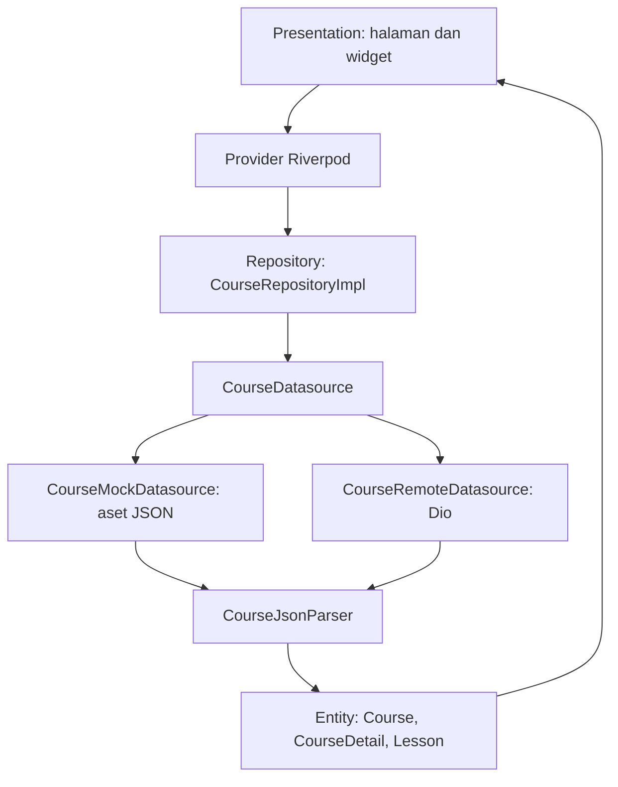

# Desain sistem

## Gambaran

Aplikasi Flutter untuk siswa yang menampilkan kelas dan pelajaran video. Tidak ada backend sendiri; data dibaca dari berkas mock yang berbentuk sama persis seperti respons API. Jika API nyata tersedia, hanya dua tempat yang berubah: `AppConfig.useMock` dan `BASE_URL`.

## Lapisan

### Presentation

`CourseListPage`, `CourseDetailPage`, `LessonPlayerPage`. Halaman hanya memakai `AsyncValue` dari Riverpod. Tidak ada logika HTTP di widget.

`core/widgets/state_view.dart` menyediakan satu tampilan untuk loading, empty, error, dan retry. Skeleton mengikuti bentuk kartu dan halaman aslinya, bukan sekadar spinner.

### Domain

Entity `Course`, `CourseDetail`, `Lesson` bersifat immutable (field final). `fromJson` ada di entity karena bentuk API dan domain identik untuk proyek ini. Tidak ada `freezed` atau `json_serializable`.

`CourseRepository` adalah kontrak abstrak. UI tidak tahu sumber datanya mock atau remote.

### Data

`CourseRepositoryImpl` menjamin semua kegagalan keluar sebagai `Failure`. `mapDioExceptionToFailure` memisahkan offline, timeout, server, 404, parsing, dan unknown agar pesan pengguna berbeda.

`CourseMockDatasource` menambah latensi 400 ms supaya kondisi skeleton bisa dilihat saat demo. `CourseRemoteDatasource` hanya membangun URL dan memanggil `ApiClient`.

## State management

Riverpod 3 dipakai untuk dependency injection dan state async. Dua provider utama:

| Provider | Dipakai di | Catatan |
|---|---|---|
| `courseListProvider` | Daftar kelas | `retry` otomatis dimatikan; tombol "Coba lagi" yang memicu `invalidate` |
| `courseDetailProvider(id)` | Detail dan pemutar | Auto-retry juga dimatikan agar pesan error tidak berkedip |

Auto-retry dimatikan dengan sengaja: pengguna harus melihat dan memilih retry, bukan menunggu loop gagal berulang.

## Routing

`go_router` dengan tiga rute:

| Rute | Halaman |
|---|---|
| `/` | Daftar kelas |
| `/courses/:courseId` | Detail kelas |
| `/courses/:courseId/lessons/:lessonId` | Pemutar pelajaran |

Rute tidak dikenal menampilkan `RouteNotFoundScreen` dengan tombol kembali ke daftar kelas.

`pushOnce` dan `_switching` mencegah dua navigasi dari tap ganda. Pergantian pelajaran memakai `pushReplacement`, bukan `push`, agar tidak menumpuk halaman pemutar.

## Lifecycle pemutar

`VideoArea` adalah pemilik `VideoPlayerController`:

1. Controller dibuat di `initState`.
2. `isActive` berubah menjadi false saat perpindahan pelajaran dimulai → video dijeda.
3. `WidgetsBindingObserver` menjeda saat aplikasi `paused`, `hidden`, atau `detached`.
4. `dispose` menjeda lalu membuang controller.

Untuk YouTube, `YoutubeVideoArea` melakukan hal yang sama lewat `pauseVideo()` dan `close()`. Tidak ada dua video yang bisa bersuara bersamaan.

`_videoKey` (GlobalKey) memindahkan elemen player yang sama antara layout portrait dan layar penuh, sehingga video tidak restart saat fullscreen toggle.

## Tiga kondisi tampilan data

| Kondisi | Tampilan |
|---|---|
| Loading | Skeleton mengikuti bentuk kartu/player |
| Empty | Pesan tanpa tombol retry |
| Error | Pesan sesuai jenis `Failure` + tombol retry bila masuk akal |
| Data | Konten penuh |

## Design token

Satu arah visual: "Kelas yang tenang". Warna utama teal `#0B6E5F`, aksenter amber `#F2A007`, netral hangat. Tipografi Plus Jakarta Sans. Skala spasi 4/8/12/16/24/32, radius 8/12. Tanpa shadow; pemisah memakai border 1 px. Ikon hanya `lucide_icons_flutter`.

Token ada di `lib/core/theme/tokens/`. Widget tidak boleh mengarang warna atau ukuran sendiri. Target sentuh minimal 48 dp. Teks diuji aman pada skala 1,3x.

## Pengujian

- Unit: parsing JSON valid/rusak, pemetaan `DioException`, repository.
- Widget: empat kondisi UI, overflow 360 dp dan 640 dp pada skala 1,3x, lifecycle player, doppelganger tap, rotasi, koneksi putus saat putar, URL invalid.
- Helper: `FakeCourseRepository`, `FakeVideoPlayerPlatform`, dan `tutorial_catalog_test.dart`.

`FakeVideoPlayerPlatform` memakai stream non-broadcast agar event "initialized" mengantre sampai controller berlangganan. Tes tidak memakai `pumpAndSettle` terus-menerus saat video berjalan karena timer posisi 100 ms tidak pernah selesai.

## Konfigurasi lingkungan

- Flutter 3.50.1 / Dart 3.14.0.
- Material berada di `package:material_ui/material_ui.dart` sejak Flutter 3.47; `flutter/material.dart` adalah legacy dan tidak dicampur.
- JDK 17 diperlukan untuk Gradle.
- Tidak ada CI; verifikasi dijalankan manual dengan `flutter analyze` dan `flutter test`.
